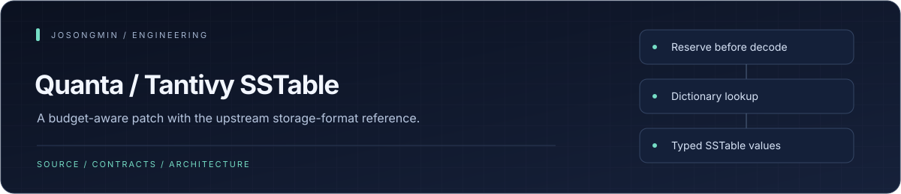
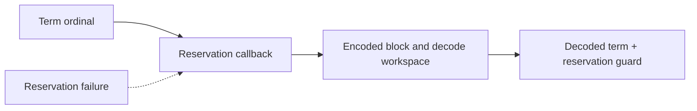

<p align="center"></p>

# Quanta Tantivy SSTable

<p align="center"><a href="#engineering-highlights">Engineering</a> · <a href="#architecture-at-a-glance">Architecture</a> · <a href="#development-and-verification">Get started</a> · <a href="#quanta-extension">Reference</a></p>

A narrow, budget-aware patch of upstream `tantivy-sstable` **0.3.0**, used by Tantivy 0.22.1. It adds caller-admitted ordinal-to-term decoding while preserving the serialized SSTable format.

This repository is a derivative of the upstream crate, not an independently authored SSTable implementation. [AUTHORS](AUTHORS), [LICENSE](LICENSE), and [quanta-provenance.json](quanta-provenance.json) retain authorship, MIT licensing, and original file digests.

## Engineering highlights

| Mechanism | Contract | Source |
| :--- | :--- | :--- |
| Budgeted ordinal lookup | `Dictionary<VoidSSTable>::ord_to_term_budgeted` accepts a fallible reservation callback before encoded I/O and decode workspace allocation. | [Dictionary](src/dictionary.rs) |
| Guard-carrying result | A successful lookup returns the decoded term together with the caller's reservation guard, preserving the caller's accounting lifetime. | [Guarded lookup](src/dictionary.rs) |
| Typed SSTable values | The upstream format separates prefix-compressed keys from value-specific codecs. | [Public types](src/lib.rs) |
| Block-level navigation | SSTable indexes identify blocks; dictionaries and streamers expose point and ordered access paths. | [Block index](src/sstable_index_v3.rs) |



The reservation callback is supplied by the consumer. This patch is not a global allocator or a complete memory-budgeting runtime. See the [dictionary implementation](src/dictionary.rs), [block reader](src/block_reader.rs), and [public exports](src/lib.rs).

## Architecture at a glance


## Quanta extension

`Dictionary<VoidSSTable>::ord_to_term_budgeted` reserves three stages through the caller's callback:

1. Encoded block I/O.
2. Decode workspace, including the bulk zstd context.
3. Exact retained output.

The returned guard accompanies the output. Temporary guards remain live through decoding and output allocation. Missing ordinals allocate nothing; refused reservations fail before the affected operation.

Bounds are owned by the codec. Unknown, overflowing, malformed, or truncated lengths are rejected instead of being interpreted as valid sizes. Valid-key ordering and the wire format remain unchanged.

## Contract limits

The budget covers requested logical buffer capacity and the bulk zstd context. It excludes allocator metadata/reallocation internals, index opening, query preparation, caches, unrelated payloads, and process RSS. The API assumes an already opened dictionary; it does not harden every upstream parser against arbitrary bytes.

Consumers patch the exact package to a full Git revision. Do not substitute an unpinned moving branch in a reproducible consumer configuration.

## Development and verification

```sh
cargo test
```

The integration regressions belong to `quanta-index-lexical` L3 tests in [Quanta Index](https://github.com/josongmin/quanta-index): reservation refusal at each stage, retained-guard lifetime, compressed predecessor workspace, typed collector refusal, and malformed deltas. Local crate tests and consumer integration remain separate evidence scopes.

[QUANTA.md](QUANTA.md) documents the patch contract and upgrade obligations. Revalidate decoder/context bounds and Rust `Vec` capacity assumptions when updating upstream.

---

## Upstream SSTable reference

<details>
<summary><strong>Read the upstream SSTable format reference</strong></summary>

The `tantivy-sstable` crate is yet another sstable crate.

It has been designed to be used in `quickwit`:

- as an alternative to the default tantivy fst dictionary.
- as a way to store the column index for dynamic fast fields.

The benefit compared to the fst crate is locality.
Searching a key in the fst crate requires downloading the entire dictionary.

Once the sstable index is downloaded, running a `get` in the sstable
crate only requires a single fetch.

Right now, the block index and the default block size have been thought
for quickwit, and the performance of a get is very bad.

## Sorted strings

SSTable stands for Sorted String Table.
Strings have to be insert in sorted order.

That sorted order is used in different ways:

- it makes gets and streaming ranges of keys
possible.
- it allows incremental encoding of the keys
- the front compression is leveraged to optimize
the intersection with an automaton

## On-disk format

Overview of the SSTable format. Unless noted otherwise, numbers are little-endian.

### SSTable

```text
+-------+-------+-----+--------+
| Block | Block | ... | Footer |
+-------+-------+-----+--------+
|----( # of blocks)---|
```

- Block(`SSTBlock`): list of independent block, terminated by a single empty block.
- Footer(`SSTFooter`)

### SSTBlock

```text
+----------+----------+--------+-------+-------+-----+
| BlockLen | Compress | Values | Delta | Delta | ... |
+----------+----------+--------+-------+-------+-----+
                      |        |----( # of deltas)---|
                      |------(maybe compressed)------|
```

- BlockLen(u32): length of the block, including the compress byte.
- Compress(u8): indicate whether block is compressed. 0 if not compressed, 1 if compressed.
- Values: an application defined format storing a sequence of value, capable of determining it own length
- Delta

### Delta

```text
+---------+--------+
| KeepAdd | Suffix |
+---------+--------+
```

- KeepAdd
- Suffix: KeepAdd.add bytes of key suffix

### KeepAdd

KeepAdd can be represented in two different representation, a very compact 1byte one which is enough for most usage, and a longer variable-len one when required

When keep < 16 and add < 16

```text
+-----+------+
| Add | Keep |
+-----+------+
```

- Add(u4): number of bytes to push
- Keep(u4): number of bytes to pop

Otherwise:

```text
+------+------+-----+
| 0x01 | Keep | Add |
+------+------+-----+
```

- Add(VInt): number of bytes to push
- Keep(VInt): number of bytes to pop

Note: as the SSTable does not support redundant keys, there is no ambiguity between both representation. Add is always guaranteed to be non-zero, except for the very first key of an SSTable, where Keep is guaranteed to be zero.

### SSTFooter

```text
+-----+----------------+-------------+-------------+---------+---------+
| Fst | BlockAddrStore | StoreOffset | IndexOffset | NumTerm | Version |
+-----+----------------+-------------+-------------+---------+---------+
```

- Fst(Fst): finite state transducer mapping keys to a block number
- BlockAddrStore(BlockAddrStore): store mapping a block number to its BlockAddr
- StoreOffset(u64): Offset to start of the BlockAddrStore. If zero, see the SingleBlockSStable section
- IndexOffset(u64): Offset to the start of the SSTFooter
- NumTerm(u64): number of terms in the sstable
- Version(u32): Currently equal to 3

### Fst

Fst is in the format of tantivy\_fst

### BlockAddrStore

+---------+-----------+-----------+-----+-----------+-----------+-----+
| MetaLen | BlockMeta | BlockMeta | ... | BlockData | BlockData | ... |
+---------+-----------+-----------+-----+-----------+-----------+-----+
          |---------(N blocks)----------|---------(N blocks)----------|

- MetaLen(u64): length of the BlockMeta section
- BlockMeta(BlockAddrBlockMetadata): metadata to seek through BlockData
- BlockData(CompactedBlockAddr): bitpacked per block metadata

### BlockAddrBlockMetadata

+--------+------------+--------------+------------+--------------+-------------------+-----------------+----------+
| Offset | RangeStart | FirstOrdinal | RangeSlope | OrdinalSlope | FirstOrdinalNBits | RangeStartNBits | BlockLen |
+--------+------------+--------------+------------+--------------+-------------------+-----------------+----------+

- Offset(u64): offset of the corresponding BlockData in the datastream
- RangeStart(u64): the start position of the first block
- FirstOrdinal(u64): the first ordinal of the first block
- RangeSlope(u32): slope predicted for start range evolution (see computation in BlockData)
- OrdinalSlope(u64): slope predicted for first ordinal evolution (see computation in BlockData)
- FirstOrdinalNBits(u8): number of bits per ordinal in datastream (see computation in BlockData)
- RangeStartNBits(u8): number of bits per range start in datastream (see computation in BlockData)

### BlockData

+-----------------+-------------------+---------------+
| RangeStartDelta | FirstOrdinalDelta | FinalRangeEnd |
+-----------------+-------------------+---------------+
|------(BlockLen repetitions)---------|

- RangeStartDelta(var): RangeStartNBits *bits* of little endian number. See below for decoding
- FirstOrdinalDelta(var): FirstOrdinalNBits *bits* of little endian number. See below for decoding
- FinalRangeEnd(var): RangeStartNBits *bits* of integer. See below for decoding

converting a BlockData of index Index and a BlockAddrBlockMetadata to an actual block address is done as follow:
range\_prediction := RangeStart + Index * RangeSlop;
range\_derivation := RangeStartDelta - (1 << (RangeStartNBits-1));
range\_start := range\_prediction + range\_derivation

The same computation can be done for ordinal.

Note that `range_derivation` can take negative value. `RangeStartDelta` is just its translation to a positive range.

## SingleBlockSStable

The format used for the index is meant to be compact, however it has a constant cost of around 70
bytes, which isn't negligible for a table containing very few keys.
To limit the impact of that constant cost, single block sstable omit the Fst and BlockAddrStore from
their index. Instead a block with first ordinal of 0, range start of 0 and range end of IndexOffset
is implicitly used for every operations.

</details>

<p align="center"><sub><a href="https://github.com/josongmin">Project map</a> · <a href="#engineering-highlights">Back to overview</a></sub></p>
